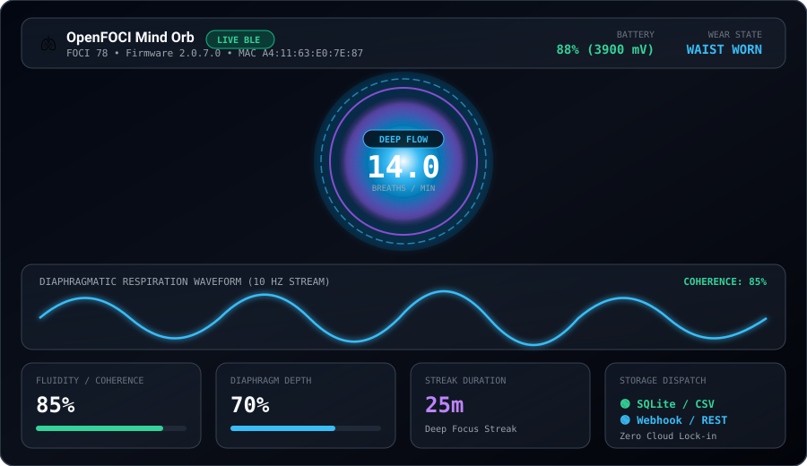
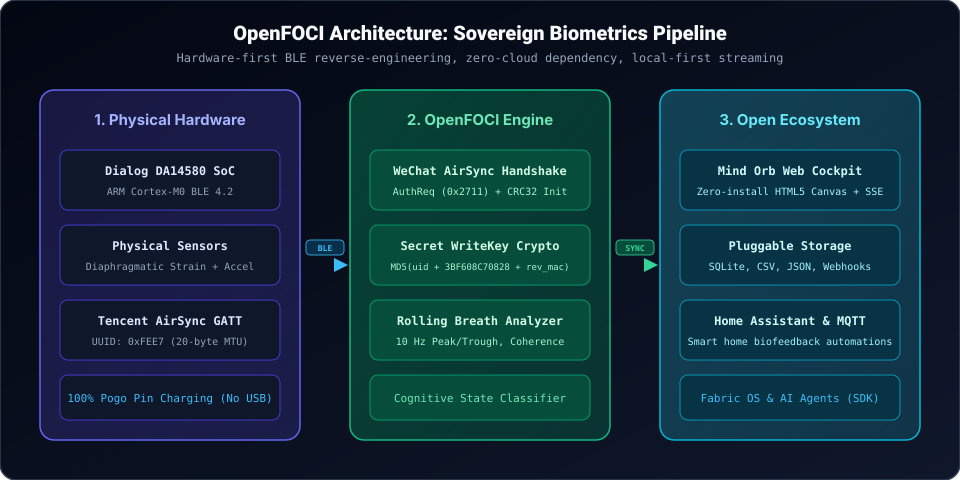

# OpenFOCI: Sovereign Biofeedback & Wearable Telemetry Engine

[](https://www.python.org/downloads/)
[](LICENSE)
[](tests/)
[](https://web-phi-lac-37.vercel.app)
[](#architecture)
[](docs/GATT_SPEC.md)

Open-source Bluetooth Low Energy (BLE) driver, real-time diaphragmatic respiration telemetry engine, and local-first **Mind Orb** biofeedback visualizer for **FOCI** and **FOCI 2** biometric wearables.

**Live Interactive Web Cockpit:** [https://web-phi-lac-37.vercel.app](https://web-phi-lac-37.vercel.app)

---

<p align="center">
  
</p>

---

## Right to Repair & Technical Backstory

Between 2018 and 2021, Cambridge-based startup **Tinylogics Ltd** raised over \$900,000 across [Kickstarter](https://www.kickstarter.com/projects/661527809/foci-wearable-that-boosts-your-focus) and [Indiegogo](https://www.indiegogo.com/projects/foci-2-boosts-your-focus-productivity-with-ai#/) from thousands of backers to produce **FOCI**, a waist-worn clip tracking diaphragmatic breathing patterns and cognitive state estimates (*Flow, Focus, Calm, Distraction, Fatigue*).

Following company dissolution in September 2025 ([UK Companies House #08954266](https://find-and-update.company-information.service.gov.uk/company/08954266)), the centralized authentication servers were deactivated and the mobile app (`com.tinylogics.foci`) was removed from distribution, stranding physical devices at a cloud login gate.

### Reverse-Engineering Findings

1. **On-Device Inference**: Digital signal processing (DSP), zero-crossing respiration rate computation, autoregressive motion parameters (AR1/AR3), and mental state classifications execute directly on the wearable's **Dialog Semiconductor DA14580 Cortex-M0 SoC**. Cloud endpoints served solely as an account/licensing check.
2. **WeChat AirSync Profile**: The peripheral advertises standard GATT Service `0xFEE7` and uses standard AirSync framing with a 4-byte CRC32 challenge.
3. **Cryptographic WriteKey Derivation**: Device authorization requires a 32-bit key computed from:
   $$\text{writeKey} = \text{MD5}\left(\text{UID} + \text{"3BF608C70828"} + \text{reversed\_mac\_hex}\right)[:4]$$
4. **Hardware Interface**: The physical magnetic cradle exposes only two contacts (+5V and GND) for charging. All diagnostic and data exchange must occur over BLE.

**OpenFOCI** restores full utility to this hardware without proprietary cloud intermediaries. It negotiates the BLE authentication handshake, streams raw 10 Hz diaphragmatic waveforms, and exposes modern visualization and data interfaces.

---

## System Architecture

<p align="center">
  
</p>

---

## Key Capabilities

- **Hardware BLE Driver**: Full asynchronous driver for WeChat AirSync (`0xFEE7` GATT) with 20-byte MTU slicing, challenge-response negotiation, and keepalive management.
- **10 Hz Respiration Oscilloscope**: Real-time diaphragmatic displacement capture isolating abdominal excursion from gross body motion.
- **Rolling Biometric Analyzer**: 60-second rolling window peak and trough detector computing respiration rate (BPM), rhythm regularity (fluidity/coherence percentage), and diaphragmatic excursion depth.
- **Mind Orb Visualizer**: Modern WebGL / Next.js cockpit with fluid particle physics responding dynamically to respiratory cycles and autonomic state indicators.
- **Pluggable Persistence**: Stream telemetry to SQLite databases, high-frequency CSV files, atomic JSON files, or forward to HTTP webhooks.
- **Home Assistant & MQTT Integration**: Automated MQTT discovery schema for home automation triggers based on autonomic state shifts.
- **Synthetic Simulation Engine**: Complete mathematical emulation generating realistic biological respiratory harmonics and state cycles for offline development without physical hardware.

---

## Quickstart

### 1. Installation

Requires Python 3.9+ and a Bluetooth 4.0+ adapter (macOS CoreBluetooth and Linux BlueZ supported).

```bash
git clone https://github.com/holy-script/OpenFOCI.git
cd OpenFOCI

# Install in editable mode
pip install -e .

# Install with testing dependencies
pip install -e ".[dev]"
```

### 2. Discover Your Clip

Ensure the clip is charged and located near your computer:

```bash
openfoci scan
```

Output:
```text
Scanning for nearby BLE devices (8 seconds)...
============================================================================
DEVICE NAME                BLE ADDRESS / UUID                   RSSI     MATCH
============================================================================
FOCI                       5C7427EA-91E6-9039-5D37-6D185EB23FC5 -61 dBm   FOCI DETECTED
============================================================================
Total discovered: 6 | FOCI targets: 1
```

### 3. Stream Live Biometrics in Terminal

```bash
openfoci stream
```

Terminal HUD:
```text
============================================================================
FOCI WEARABLE TELEMETRY HUD (OpenFOCI Core)
============================================================================
Device:        FOCI 78 (a4:11:63:e0:7e:87)
Connection:    CONNECTED
Wearing State: Worn on waistband
Battery:       88% (3900 mV)
Mental State:  FLOW (Confidence: 85%)
Respiration:   14.0 breaths/min
Fluidity:      85% coherence
Excursion:     70% diaphragmatic depth
Streak:        Focus Streak (25 min)
============================================================================
```

### 4. Launch the Mind Orb Cockpit

Run the local web dashboard and SSE stream:

```bash
openfoci serve --port 8080
```

Open [http://localhost:8080](http://localhost:8080) to inspect the live fluid Mind Orb and real-time 10 Hz oscilloscope, or explore the hosted dashboard directly at [https://web-phi-lac-37.vercel.app](https://web-phi-lac-37.vercel.app).

---

## Python SDK Example

Integrate OpenFOCI directly into custom analytics, agents, or automation loops:

```python
import asyncio
from openfoci.client import FociDevice, FociBleDriver

async def main():
    device = FociDevice(mac="a4:11:63:e0:7e:87")

    def handle_telemetry(snapshot):
        bpm = snapshot["breath"]["respirationRate"]
        coherence = snapshot["breath"]["fluidity"]
        state = snapshot["mentalState"]
        battery = snapshot["batteryLevel"]
        print(f"[{state.upper()}] {bpm:.1f} bpm | Coherence: {coherence}% | Battery: {battery}%")

    driver = FociBleDriver(device, on_telemetry=handle_telemetry)
    await driver.run()

if __name__ == "__main__":
    asyncio.run(main())
```

---

## Project Roadmap

- [x] **Phase 1: BLE Protocol Reverse-Engineering**
  - [x] AirSync GATT service (`0xFEE7`) identification and 20-byte MTU slicing
  - [x] AuthRequest (`0x2711`) and CRC32 InitRequest (`0x2713`) challenge resolution
  - [x] `writeKey` derivation formula extraction
  - [x] Continuous `0x4E22` SendData ACK loop
- [x] **Phase 2: Local Core Driver & Web Cockpit**
  - [x] Asynchronous Python driver (`openfoci.client.FociBleDriver`)
  - [x] 60-second rolling breath detector and coherence scoring
  - [x] Modern WebGL Mind Orb cockpit with real-time SSE stream
  - [x] Terminal biofeedback meter (`openfoci stream`)
- [x] **Phase 3: Pluggable Storage & Integrations**
  - [x] SQLite time-series storage with indexed timestamps
  - [x] High-frequency CSV sample exporter
  - [x] Atomic JSON snapshot writer for local system daemons
  - [x] Webhook / REST forwarding adapter
  - [x] Home Assistant MQTT auto-discovery configuration
- [x] **Phase 4: Offline Android APK Repackaging**
  - [x] Smali bytecode patch on `TrackerSDK.smali` (`checkLoginStatus -> true`)
  - [x] Smali bytecode patch on `AccountManager.smali` (`hasAutoLoginToken -> true`, default UID `1001`)
  - [x] Smali bytecode patch on `SplashViewPagerActivity.smali` (`loginSuccessFinished()` in `onCreate`)
  - [x] Automated APK patcher script (`tools/patch_apk.sh`)
- [ ] **Phase 5: PyPI Release & Multi-OS CI/CD**
  - [ ] PyPI distribution package (`pip install openfoci`)
  - [ ] GitHub Actions CI across macOS, Linux, and Windows
- [ ] **Phase 6: Advanced Respiratory Sinus Arrhythmia (RSA) Model**
  - [ ] Temporal Convolutional Network (TCN) trained on raw 10 Hz strain data
  - [ ] Autonomic nervous system tone estimation (HRV proxy)
  - [ ] Personalized user calibration profiles

---

## Technical Specifications & References

- [GATT Specification (docs/GATT_SPEC.md)](docs/GATT_SPEC.md): Full breakdown of UUIDs, byte offsets, opcodes, and bitmasks.
- [Protocol Reverse-Engineering Dossier (docs/PROTOCOL_BREAKDOWN.md)](docs/PROTOCOL_BREAKDOWN.md): Technical analysis of packet structures, cryptographic derivations, and firmware registers.
- [Home Assistant Guide (docs/HOME_ASSISTANT.md)](docs/HOME_ASSISTANT.md): Setup instructions for MQTT telemetry streaming and biofeedback automations.

---

## License

This project is licensed under the **MIT License** — see [LICENSE](LICENSE) for details.

*Disclaimer: OpenFOCI is an independent open-source hardware liberation and right-to-repair research project. It is not affiliated with, endorsed by, or sponsored by Tinylogics Ltd or its successors.*
